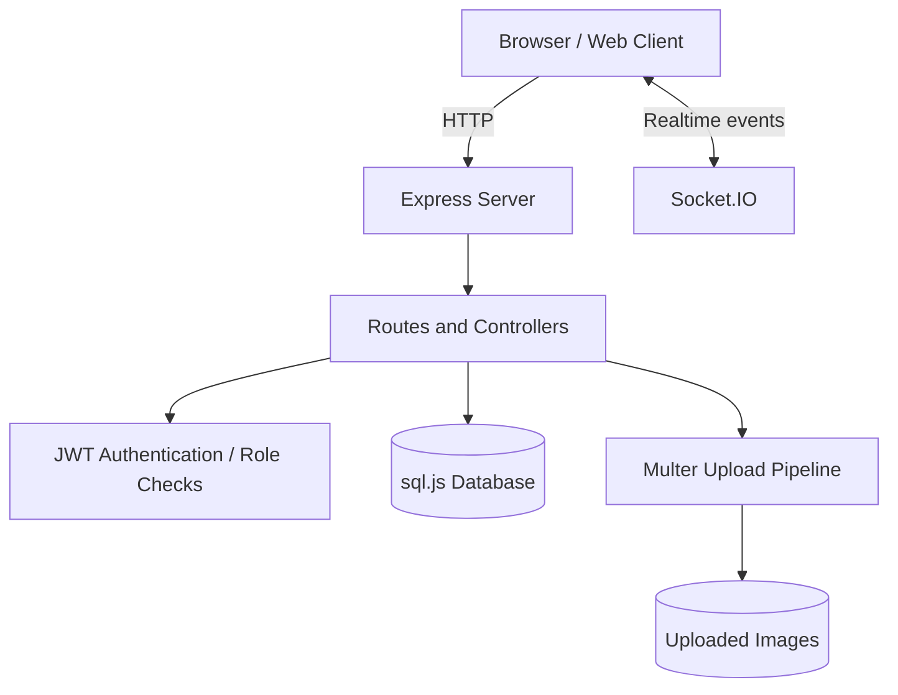

 <div align="center">


# Mirhaj Real Estate

### A Web Application for Real Estate Workflows

A real-estate web application project focused on property-related workflows, application-server functionality, and user-facing features.


[Overview](#overview) · [Architecture](#architecture-at-a-glance) · [Setup](#getting-started) · [Security](#security-and-deployment-status)

</div>

---

## Overview

Mirhaj Real Estate is a web application project for real-estate workflows. The repository combines a Node.js/Express server, browser-based frontend, a `sql.js` database layer, JWT authentication, image-upload handling, and Socket.IO events.

This repository is an active software project—not a certification of production readiness. The documentation below distinguishes implemented code paths from behaviors that still require integration and security testing.

## Technology Stack

| Technology | Role |
| --- | --- |
| Node.js + Express | HTTP server, middleware, and route handling |
| JavaScript | Frontend and backend application logic |
| sql.js | SQLite-compatible database running in JavaScript |
| JWT + bcrypt | Token authentication and password hashing |
| Socket.IO | Real-time event delivery |
| Multer | Multipart image upload handling |
| PWA assets | Progressive web app resources |

## Architecture at a Glance



This is a code-oriented architecture overview. It does not imply every route, authorization rule, or end-to-end workflow has passed runtime testing.

## Project Areas

- Property-related API routes and controllers.
- User registration, login, and profile routes.
- JWT authentication middleware and role checks.
- Image upload, listing, and deletion workflows.
- Messaging and Socket.IO integration.
- Database initialization, indexes, and seed data.
- Frontend assets and PWA-related resources.

## Getting Started

### Prerequisites

- Node.js with support for the APIs used by the project.
- npm.
- Git.

### Install

```powershell
git clone https://github.com/amirreza91-13/mirhaj-realestate.git
Set-Location mirhaj-realestate
npm install
```

### Configure environment variables

Create a local environment file:

```powershell
Copy-Item .env.example .env
node -e "console.log(require('crypto').randomBytes(48).toString('base64url'))"
```

Set the generated value as `JWT_SECRET`. Also set a unique `INITIAL_MANAGER_USERNAME` and an `INITIAL_MANAGER_PASSWORD` of at least 16 characters before the first database initialization.

Set `CORS_ORIGINS` to a comma-separated list of exact trusted browser origins, including scheme and port when relevant. For example:

```dotenv
CORS_ORIGINS=https://example.com,https://www.example.com
```

Do not put paths such as `/dashboard` in origin entries. Keep `.env` private and never commit it.

### Run locally

```powershell
npm run dev
```

Or start without the watch mode:

```powershell
npm start
```

The server defaults to port `3000`. The health endpoint is available at `/api/health` after successful startup.

The `prod` script currently uses POSIX shell syntax to set `NODE_ENV`; it may not run as written in Windows PowerShell without a cross-platform environment-variable tool or a script adjustment.

## Security and Deployment Status

Recent hardening in the repository includes:

- A configured JWT secret is required; the middleware rejects secrets shorter than 32 characters.
- Initial manager creation requires explicit environment credentials rather than a built-in default password.
- HTTP and Socket.IO CORS share an explicit origin allowlist via `CORS_ORIGINS`.
- JSON and URL-encoded request bodies have size limits.
- Image uploads restrict filename extensions and declared MIME types, limit file size to 5 MB, limit each upload request to one file, and use cryptographically generated filenames.
- Authenticated Socket.IO clients are checked against active user records before joining private user rooms.

**Important limitations still remain:**

- Extension and client-declared MIME checks are not a substitute for inspecting the actual file signature or safely decoding/re-encoding images.
- Existing database files are not automatically migrated to remove accounts created by older versions. Rotate any old manager credentials and audit access before exposing an existing installation.
- The route/controller layer still needs a complete authorization and input-validation review. For example, property detail visibility and access rules should be checked consistently for inactive records.
- CORS is not an authentication mechanism; deployment still requires HTTPS, secure secret handling, backups, and route-level security testing.
- No full production deployment, browser end-to-end suite, or penetration test is claimed by this README.

**Production status: not certified production-ready.** Treat the current work as targeted hardening, not a complete security audit.

## Verification Status

The changes documented here are source-level changes. The full application has not been certified through a clean install, live server smoke test, browser walkthrough, or automated security test suite. Screenshots should be added only after the corresponding application screens have been run and verified.

## Recommended Next Steps

1. Add repeatable smoke tests for startup, health check, registration, login, and protected routes.
2. Verify file contents by signature and image decoding, not only extension/MIME metadata.
3. Review authorization and inactive-record behavior across all property and account endpoints.
4. Test CORS from allowed and rejected origins for both HTTP and Socket.IO.
5. Test database backup/restore and recovery from interrupted writes.
6. Capture genuine screenshots after the application runs successfully.

## Contributing

Before changing a workflow, identify its route/controller, define expected behavior, and add a reproducible test for the change.

## License

A `LICENSE` file is present in this repository. Review it for the applicable terms before reusing or redistributing the project.

---

<div align="center">

**Built with JavaScript for practical real-estate workflows.**

[Repository](https://github.com/amirreza91-13/mirhaj-realestate)

</div>
